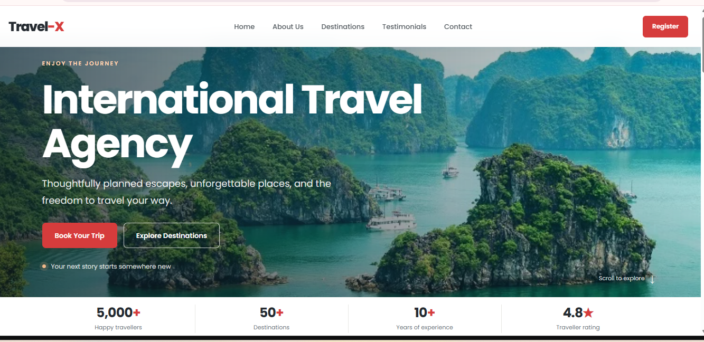
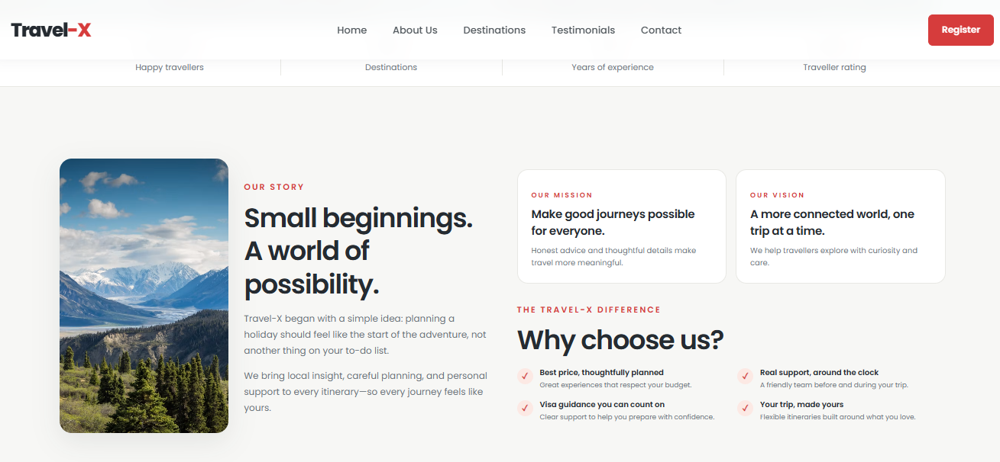
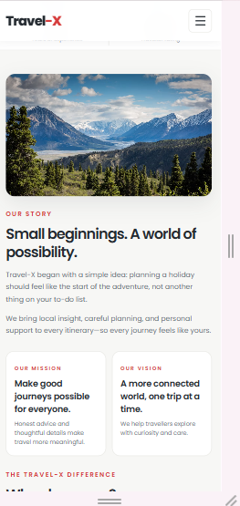

# Travel-X | International Travel Agency Landing Page

**Intern:** Neha Khatri
**Track:** Web Development
**Task:** Level 1 - Landing Page
**Tech Stack:** HTML5, CSS3 (no JavaScript)

## About the Project
Travel-X is a responsive, single-page landing page for an international travel agency. The page scrolls through five sections: Home, About Us, Destinations, Testimonials and Contact. It is built with only HTML5 and CSS3, using Flexbox and Grid for layout.

## Features
- **Sticky navigation bar** with 5 links (Home, About Us, Destinations, Testimonials, Contact) and a Register button
- **CSS-only mobile menu** (hamburger menu built with the checkbox technique, no JavaScript)
- **Hero section** with a headline, subheadline and two call-to-action buttons (Book Your Trip, Explore Destinations)
- **Stats strip** showing 5,000+ happy travellers, 50+ destinations, 10+ years of experience and a 4.8 rating
- **About Us section** with the company story, mission, vision and a "Why choose us" checklist
- **Destinations section** with 6 image cards (Manali, Munnar, Shimla, Bali, Ha Long Bay, Maldives), each with a description and a Book Now button
- **Testimonials section** with 3 traveller reviews and a final call-to-action banner
- **Contact section** with contact details and an enquiry form (name, email, phone, destination, message)
- **Footer** with quick links and placeholder social media links
- Smooth scrolling between sections
- Hover effects on buttons and cards using CSS transitions

## Design Details
- **Colour palette:** red primary (#d63c3c), warm accent (#e9a96b), dark text (#252b31) and a light background (#f7f7f5), defined as CSS variables in `:root`
- **Typography:** Poppins (Google Fonts) with a clear size difference between headings and body text
- **Layout:** `box-sizing: border-box` applied globally, with consistent padding and margins so no elements overlap
- **Responsive design:** media queries at 1000px, 760px and 560px so the page adapts to tablet and mobile screens
- **Accessibility:** semantic tags (`header`, `nav`, `main`, `section`, `footer`), alt text on images and `prefers-reduced-motion` support

## Task Checklist
- [x] Fixed/sticky navigation bar with at least 3 links
- [x] Hero section with headline, subheadline and call-to-action button
- [x] At least 2 distinct content sections
- [x] Footer with placeholder contact/social links
- [x] Consistent colour palette across all sections
- [x] Responsive layout using Flexbox and Grid
- [x] No element overlap, with intentional padding, margin and box-sizing
- [x] Clean typography with heading and body font sizes

## Project Structure
```
WebDev-L1-LandingPage/
├── index.html
├── style.css
├── Most-Beautiful-Places-in-the-World.webp
├── README.md
└── screenshots/
    ├── desktop-hero.png
    ├── desktop-sections.png
    └── mobile.png
```

## How to Run
1. Download or clone this repository.
2. Open the `WebDev-L1-LandingPage` folder.
3. Open `index.html` in any web browser, or use the VS Code Live Server extension.
4. An internet connection is needed to load the Google Fonts and the Unsplash images.

## Screenshots
### Desktop



### Mobile


## Credits
- Fonts: [Google Fonts - Poppins](https://fonts.google.com/specimen/Poppins)
- Images: [Unsplash](https://unsplash.com) and a hero background image
- All names, prices, email and phone number on the page are placeholders for this task.
