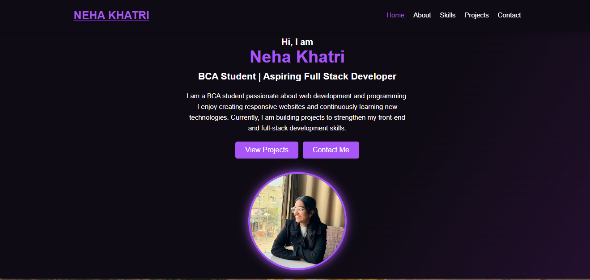
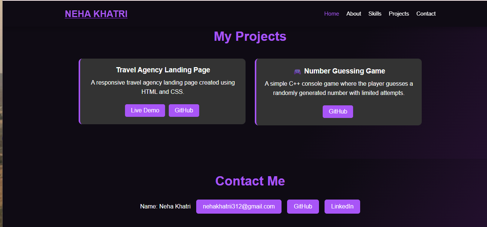
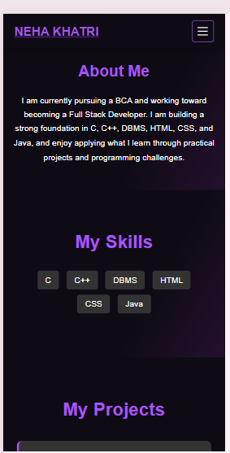
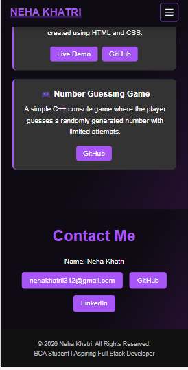

# Neha Khatri | Personal Portfolio

- **Intern:** Neha Khatri
- **Track:** Web Development and Designing
- **Task:** Level 1 - Task 2 - Portfolio
- **Tech Stack:** HTML5, CSS3

## About the Project
A responsive personal portfolio website that introduces me as a BCA student and aspiring Full Stack Developer. It presents my skills, projects and contact links in a clean dark theme with a purple accent.

## Sections
- **Home:** greeting, name, role (BCA Student | Aspiring Full Stack Developer), short introduction, "View Projects" and "Contact Me" buttons, and a profile photo
- **About Me:** short introduction about my BCA studies and my goal of becoming a Full Stack Developer
- **My Skills:** C, C++, DBMS, HTML, CSS and Java
- **My Projects:** project cards with Live Demo and GitHub buttons
  - Travel Agency Landing Page (HTML and CSS)
  - Number Guessing Game (C++ console game)
- **Contact Me:** email, GitHub and LinkedIn buttons
- **Footer:** copyright and role line

## Features
- Sticky navigation bar with links to every section (Home, About, Skills, Projects, Contact)
- Mobile menu for small screens
- Responsive layout that adapts to desktop and mobile
- Consistent dark theme with a purple accent colour
- Hover effects on buttons and project cards
- Profile photo with a glowing purple border

## Projects Featured
| Project | Description | Links |
|---|---|---|
| Travel Agency Landing Page | A responsive travel agency landing page created using HTML and CSS | [Live Demo](https://nehakhatrii312.github.io/OIBSIP/WebDev-L1-LandingPage/) / [GitHub](https://github.com/nehakhatrii312/OIBSIP/tree/main/WebDev-L1-LandingPage) |
| Number Guessing Game | A simple C++ console game where the player guesses a randomly generated number with limited attempts | [GitHub](https://github.com/nehakhatrii312/number-guessing-game.cpp) |

## Live Demo
https://nehakhatrii312.github.io/OIBSIP/WebDev-L1-Portfolio/

## Project Structure
```
WebDev-L1-Task 2-Portfolio/
├── index.html
├── (profile photo)
├── README.md
└── screenshots/
    ├── desktop-home.png
    ├── desktop-projects.png
    ├── mobile-about.png
    └── mobile-contact.png
```

## How to Run
1. Download or clone this repository.
2. Open the `WebDev-L1-Portfolio` folder.
3. Open `index.html` in any web browser, or use the VS Code Live Server extension.

## Screenshots
### Desktop



### Mobile



## Credits
- Designed and developed by Neha Khatri as part of the Oasis Infobyte Web Development internship.
